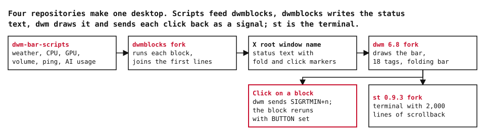

# dwm: local X11 window-manager fork

[Polski](README.pl.md)

A configured fork of suckless dwm 6.8 for a Linux workstation. The upstream
window manager provides tiling, floating and monocle layouts; this checkout adds
local status-bar integration and desktop controls.



## What is in this fork

| Area | Implementation |
|---|---|
| Status bar | Colour controls, hover expansion at byte `0x1f`, and per-block mouse buttons sent to `dwmblocks` using queued real-time signals. Hit testing uses the displayed text. |
| Workspace controls | The tracked `config.h` selects Super, 18 tags, column focus and tag cycling. |
| Desktop behaviour | Window state saved for a dwm restart; monitor pointer barriers when XFixes 5 and XInput 2.3 are available. |
| Local bindings | Audio, brightness, screenshots and other workstation commands in `config.h`. Some point to `/home/ms` helpers outside this repository. |

## Build and check

Requires a C compiler, make, and development headers/libraries for Xlib, Xft,
Fontconfig, FreeType, Xinerama, Xfixes and Xi. Review [config.mk](config.mk) for
library paths and the installation prefix (`/usr/local` by default).

```sh
make
sh tests/build-default.sh
```

The first command builds with the **tracked [config.h](config.h)**. The second
builds a temporary copy using [config.def.h](config.def.h); it does not change
your configuration or start X. The template is a simpler configuration, not a
copy of the local key bindings.

## Use on your own desktop

Review the commands, fonts and paths in `config.h` before installing. The local
configuration expects JetBrainsMono Nerd Font, `st`, `dmenu_run`, `clipmenu`,
`pactl` and several external helpers. Missing launchers do not prevent compilation.
Rebuild after configuration changes. `make install` installs the binary and man
page to the selected prefix; changing an existing desktop session is a separate step.

An X session can start dwm with `exec dwm` in `.xinitrc`. Start one status producer
separately: this checkout is paired with
[dwmblocks](https://gitlab.com/maciejszulia/dwmblocks), whose optional helpers are
in [dwm-bar-scripts](https://gitlab.com/maciejszulia/dwm-bar-scripts).
Click routing also requires `pidof` and Linux `/proc`. A successful build does
not verify monitor layout, installed helpers or interaction in a live X session.

## Upstream and licence

Based on [suckless dwm](https://dwm.suckless.org/). The original authors and
MIT/X Consortium terms remain in [LICENSE](LICENSE). See [dwm.1](dwm.1) for the
upstream manual; [config.h](config.h) is authoritative for this fork's bindings.
