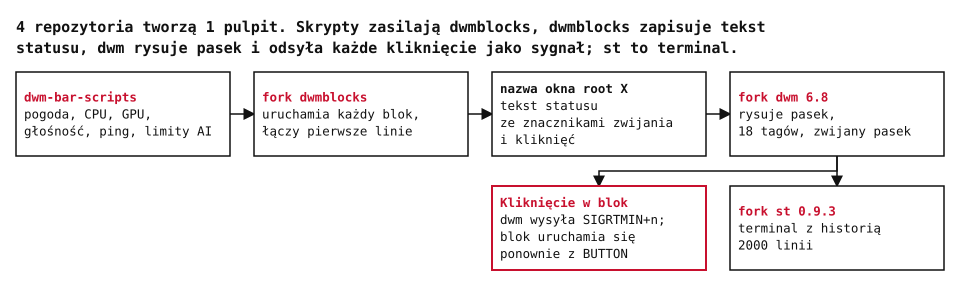

# dwm: lokalny fork menedżera okien X11

[English](README.md)

Skonfigurowany fork suckless dwm 6.8 dla stacji roboczej z Linuksem. Menedżer okien z upstreamu daje układy kafelkowy, pływający i monocle. Ten fork dodaje integrację z lokalnym paskiem stanu i sterowanie pulpitem.



## Co zawiera ten fork

| Obszar | Implementacja |
|---|---|
| Pasek stanu | Kolory, rozwijanie po najechaniu kursorem przy bajcie `0x1f` i przyciski myszy dla każdego bloku. dwm wysyła kliknięcia do `dwmblocks` jako kolejkowane sygnały czasu rzeczywistego. Trafienie kursorem dwm liczy według wyświetlanego tekstu. |
| Sterowanie obszarami roboczymi | Śledzony plik `config.h` wybiera klawisz Super, 18 tagów, fokus kolumn i przełączanie tagów w pętli. |
| Zachowanie pulpitu | Stan okien przetrwa restart dwm. Bariery kursora między monitorami działają, gdy dostępne są XFixes 5 i XInput 2.3. |
| Lokalne skróty | Dźwięk, jasność, zrzuty ekranu i inne komendy stacji roboczej w `config.h`. Część skrótów wskazuje skrypty z `/home/ms`, które leżą poza tym repozytorium. |

## Budowa i sprawdzenie

Wymagane są: kompilator C, make oraz nagłówki i biblioteki Xlib, Xft, Fontconfig, FreeType, Xinerama, Xfixes i Xi. Sprawdź w [config.mk](config.mk) ścieżki bibliotek i prefiks instalacji (domyślnie `/usr/local`).

```sh
make
sh tests/build-default.sh
```

Pierwsza komenda buduje program ze **śledzonym plikiem [config.h](config.h)**. Druga komenda buduje kopię tymczasową z [config.def.h](config.def.h); nie zmienia konfiguracji i nie uruchamia X. Szablon jest prostszą konfiguracją, a nie kopią lokalnych skrótów.

## Użycie na własnym pulpicie

Przed instalacją przejrzyj komendy, czcionki i ścieżki w `config.h`. Lokalna konfiguracja oczekuje czcionki JetBrainsMono Nerd Font, programów `st`, `dmenu_run`, `clipmenu` i `pactl` oraz innych zewnętrznych skryptów. Brakujące programy nie blokują kompilacji. Po zmianie konfiguracji zbuduj program ponownie. `make install` instaluje plik wykonywalny i stronę man w wybranym prefiksie; zmiana działającej sesji pulpitu to osobny krok.

Sesja X uruchamia dwm wpisem `exec dwm` w `.xinitrc`. Program, który wypisuje stan, uruchom osobno: ten fork współpracuje z [dwmblocks](https://gitlab.com/maciejszulia/dwmblocks), a opcjonalne skrypty leżą w [dwm-bar-scripts](https://gitlab.com/maciejszulia/dwm-bar-scripts). Obsługa kliknięć wymaga też `pidof` i linuksowego `/proc`. Udana kompilacja nie sprawdza układu monitorów, zainstalowanych skryptów ani pracy w działającej sesji X.

## Upstream i licencja

Fork bazuje na [suckless dwm](https://dwm.suckless.org/). Pierwotni autorzy i warunki licencji MIT/X Consortium są w [LICENSE](LICENSE). Podręcznik upstreamu to [dwm.1](dwm.1); o skrótach tego forka rozstrzyga [config.h](config.h).
